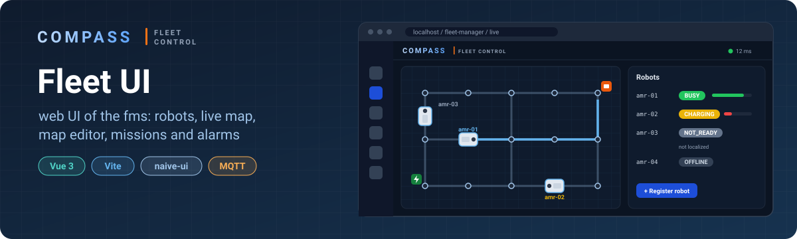
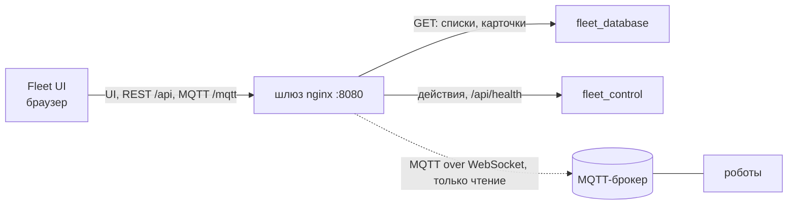

<p align="center">
  
</p>

# Fleet UI

**Веб-интерфейс fms — системы управления парком мобильных роботов.**

Оператор видит роботов и их готовность к работе, следит за ними на карте, рисует карты с графом маршрутов,
создаёт миссии и разбирает тревоги. Сам UI ничего не решает: действия он отправляет в fms, данные читает
из fms, а живую позу роботов берёт напрямую из MQTT-брокера.

> **Идёт переход на контракт API v2** ([`docs/API_CONTRACT.md`](docs/API_CONTRACT.md)). Роботы уже на v2:
> регистрация, удаление, пауза, готовность к работе (`availability`) на всех экранах, живая поза из MQTT `amr/v3`.
> Карты тоже в fms: версия, конфликт при одновременном сохранении, черновик несохранённых правок.
> Дальше — миссии и тревоги, по мере того как их сделает fms (пока mock).

## Как устроено



- **Один адрес.** Шлюз fms (`deploy/` в репозитории fms) раздаёт собранный UI, API и MQTT с одного порта:
  UI открывается по `http://<машина>:8080/`, ходит на `/api` и `/mqtt` того же адреса, CORS не нужен.
- **Чтение** — опросом REST: роботы раз в 5 с, пауза, пока вкладка скрыта.
- **Действия** (зарегистрировать, удалить, пауза) — через fleet_control; результат виден при следующем опросе.
- **Живая поза** (5–10 Гц) — из брокера, через шлюз: топики `visualization` и `connection` каждого робота.
  Публиковать в брокер UI ничего не может: у его пользователя права только на чтение.
- **Mock-режим** — те же экраны без сервера: каждая функция `src/api/*` в mock-режиме отвечает сама.

## Экраны

| Путь | Что | Данные |
|---|---|---|
| `/dashboard` | сводка по парку: сколько роботов в каком состоянии, заряд | fms |
| `/live` | карта с роботами в реальном времени | fms + MQTT |
| `/maps`, `/maps/:id` | список карт и редактор: граф, станции, зоны и атрибуты VDA 5050 v3, дороги, импорт и экспорт LIF / Nav2 | fms |
| `/robots` | парк роботов: регистрация, состояние, удаление | fms |
| `/missions` | мастер миссии (шаги по узлам карты) и список | пока mock |
| `/alarms` | тревоги: фильтры, подтверждение | пока mock |
| `/settings` | адрес fms, mock-режим, тема | |

Ручного управления (teleop) в UI нет: по контракту это делается напрямую с роботом, не через fms.

## Настройка

Адреса задаются в `public/config.js` — после сборки он лежит рядом с `index.html` в `dist/`, его можно править
без пересборки:

| Поле | Пример | Что |
|---|---|---|
| `apiBaseUrl` | `/api` | шлюз fms; в dev — полный адрес, `http://192.168.0.105:8080/api` |
| `useMocks` | `false` | `true` — без сервера, `null` — как в сборке |
| `mqttUrl` | `ws://192.168.0.105:8080/mqtt` | брокер через шлюз; пусто — MQTT выключен |
| `mqttUser`, `mqttPassword` | `fleet-ui` | пользователь брокера только на чтение ([`docs/MOSQUITTO_SETUP.md`](docs/MOSQUITTO_SETUP.md)) |
| `mqttInterface`, `mqttVersion` | пусто | начало топиков роботов; пусто = `amr` / `v3` |

Приоритет: переключатель в Settings → `config.js` → `.env.local` (`VITE_API_BASE_URL`, `VITE_USE_MOCKS`) → mock.
Локальные адреса в git не коммитим: в репозитории `config.js` с пустыми полями. При раздаче через шлюз fms
`config.js` из сборки заменяется на `deploy/ui/config.js` репозитория fms — он берёт адреса из адреса страницы.

## Запуск

```bash
npm install
```

```bash
npm run dev
```

Откроется `http://localhost:5175/fleet-manager/`. Сборка и её проверка:

```bash
npm run build && npm run preview
```

Тесты — unit (Vitest) и e2e (Playwright; браузеры для него ставятся один раз командой `npx playwright install`):

```bash
npm test
```

```bash
npm run test:e2e
```

## Стек

Vue 3 · Vite · Pinia · Vue Router · Tailwind CSS v4 · naive-ui · v-network-graph (редактор карт) · Zod (проверка
ответов сервера) · chart.js · mqtt.js. JavaScript без TypeScript.

## Документы

| Файл | Что |
|---|---|
| [`docs/API_CONTRACT.md`](docs/API_CONTRACT.md) | контракт UI ↔ fms — источник истины для обеих сторон |
| [`docs/MOSQUITTO_SETUP.md`](docs/MOSQUITTO_SETUP.md) | брокер для UI: WebSocket-listener, пользователь только на чтение |
| [`docs/SEMYON_QUICKSTART.md`](docs/SEMYON_QUICKSTART.md) | запуск и типичные грабли |
| [`docs/DECISIONS.md`](docs/DECISIONS.md) | принятые решения |
| [`docs/VDA5050_EN.md`](docs/VDA5050_EN.md) | протокол роботов VDA 5050 v3 |
| [`CLAUDE.md`](CLAUDE.md) | правила работы над репозиторием и устройство кода |
